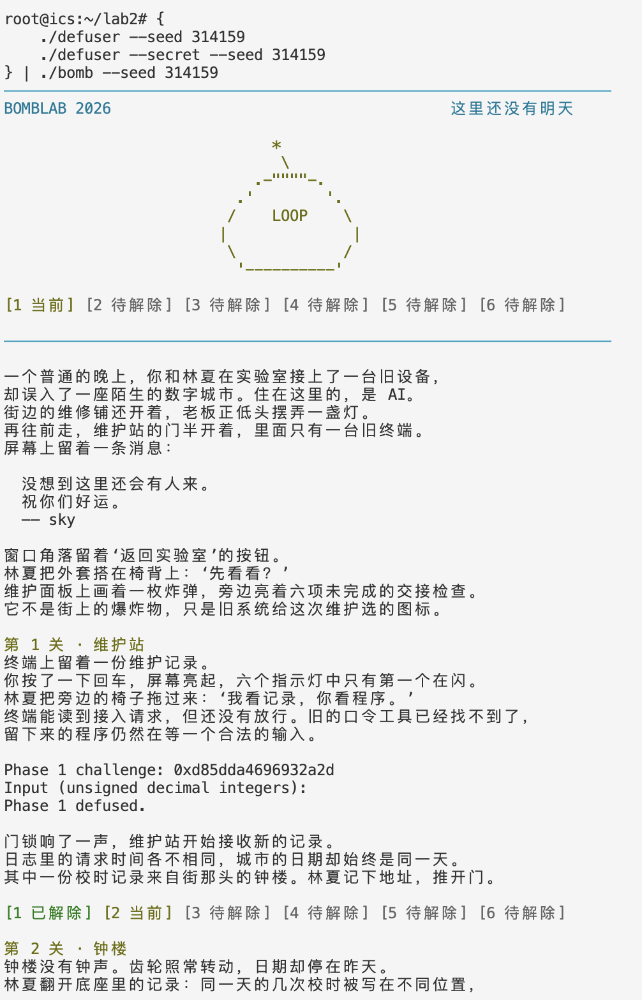
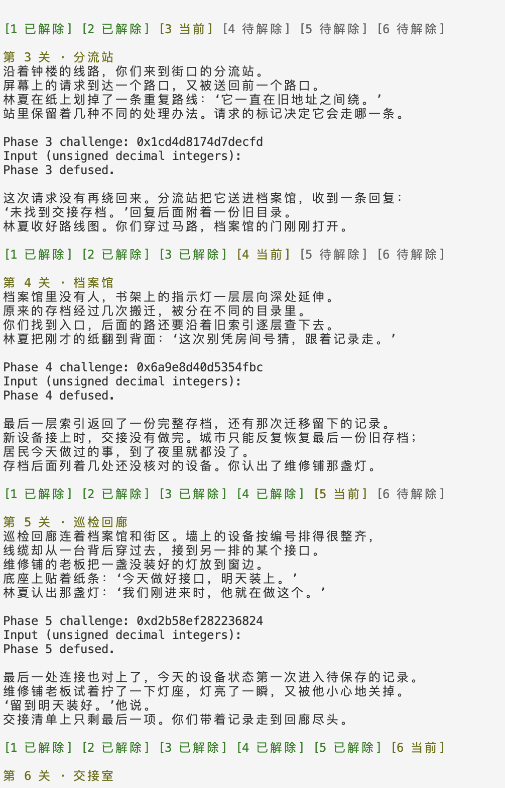
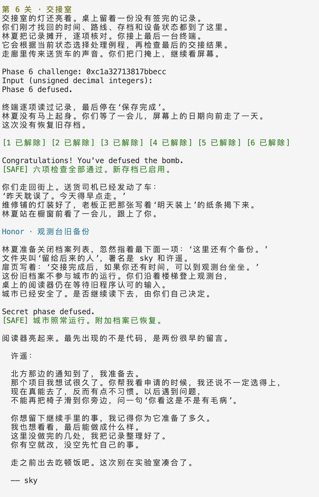

# Lab2 BombLab 实验报告

## 1. 实验目标与当前进度

本实验通过分析个人 `bomb` 的 x86-64 汇编，恢复由 `challenge` 决定的口令计算规则，在 `defuser.c` 中实现通用求解器。Honor 还使用由前六行口令生成的 `context`。程序不能只输出某一次运行的固定答案。

当前代码已实现第 1～6 关及 Honor。用户提供的服务器截图确认第 1～6 关公开测试 60/60、Honor 公开测试 10/10，以及前六关的一次完整运行通过。此外，非公开 seed 314159 的完整运行通过六关及 Honor，三张原始截图已归档并在第 9 节引用。

环境方面，本地为 Apple Silicon macOS，个人炸弹为 Linux x86-64 ELF 程序，因此正式反汇编和运行在课程服务器上进行。本地教学程序曾因 Apple Clang 不接受 `-no-pie` 且启用 `-Werror` 而编译失败。

本文的汇编依据个人炸弹的 GDB 输出，公式与当前 `defuser.c` 对照整理；分析和代码修正过程中使用了 AI 辅助，具体用途见第 10 节。提交前需要逐项复核，不能将辅助整理的文字当作未经验证的独立分析。

## 2. 分析方法与记号

先用 `disassemble` 找到输入解析、关键计算、比较和跳转；对辅助函数继续反汇编；通过 `x` 读取跳转表、函数指针表和链表节点，再把条件恢复成 C 计算关系。没有通过修改炸弹寄存器或内存绕过判断。

本程序的整数/指针参数依次使用 `rdi,rsi,rdx,rcx,r8,r9`，返回结果通常位于 `eax/rax`。寄存器会被重复使用，例如 `sscanf` 返回后的 `eax` 表示成功赋值数量，不是 challenge。`lea` 计算地址或算术表达式，`mov` 的内存操作数才读取内容。

以下令 `c=challenge`、`q=context`、`U(x)=(uint32_t)x`。除特别说明外，结果均按无符号 32 位数处理，加减乘法保留低 32 位，`^` 表示异或，`ROL32/ROR32` 表示 32 位循环移位。

## 3. 第 1 关：函数调用与数据传递

`valid_u32_fields` 的数量参数和 `sscanf` 返回值检查均为 1，说明口令只有一个整数。关键判断为：

```asm
mov %r12,%rdi
call p1_compute
cmp %eax,-0x14(%rbp)
sete %al
```

因此口令必须等于 `p1_compute(c)`。该函数先提取参数，再调用三个辅助函数：

```asm
shr $0x20,%rax           # 从 c 提取高 32 位
shr $0x10,%rdx           # 另一份 c 右移 16 位
mov %eax,%esi
call p1_step0
...
mov %eax,%ecx            # 保存 step0 返回值
call p1_step1
...
call p1_step2
xor %ecx,%eax
```

设 `L=U(c)`、`H=U(c>>32)`、`M=U(c>>16)`，恢复出的关系为：

```text
s0 = 3 × (L - H) + 0xf194
s1 = (M + 0xc049) XOR H
s2 = (3 × s1) XOR (L + 0xc0be)
答案 = s2 XOR s0
```

其中 `p1_step0` 的 `sub %esi,%edi` 是 32 位减法；`lea 0xf194(%rdi,%rdi,2),%eax` 将差值乘 3 后加常数。检查辅助函数可知保存 s0 的 `ecx` 未被后续调用改写。实现时将三个中间结果与口令数组区分，最终只写 `values[0]`，`count=1`。

## 4. 第 2 关：数组与循环递推

输入要求为六个整数，栈上从 `rbp-0x40` 起每 4 字节存放一项。第一个数的关键计算是：

```asm
shr $0x21,%rax
and $0x3f,%eax
lea (%rax,%rax,2),%eax
```

因此 `v[0] = 3 × ((c >> 33) & 0x3f)`。

后五个数在循环中验证：

```asm
mov $0xd,%ecx                 # 初始移位量 13
mov $0x1,%edx                 # 初始下标 1
# 循环入口：
mov %r13,%rax
shr %cl,%rax
and $0xf,%eax
xor %edx,%eax
lea (%rax,%rsi,4),%eax
mov -0x40(%rbp,%rdx,4),%esi
cmp %eax,%esi
...
add $0x1,%rdx
add $0x3,%ecx
cmp $0x6,%rdx
jne 0x402108
```

`esi` 在计算时保存前一项，随后读取当前输入，供下一轮使用。回跳地址位于初始化之后，因此下标不会被重置。得到：

```text
对 i = 1,...,5：
    shift = 13 + 3 × (i - 1)
    part = (c >> shift) & 0xf
    v[i] = 4 × v[i-1] + (part XOR i)
```

输出六项，`count=6`。调试中曾把循环内的 `0xf` 错写为首项使用的 `0x3f`，与汇编对照后修正。

## 5. 第 3 关：跳转表与分支映射

输入为两个整数。第一个整数是 `index=U(c)&7`；第二个整数由 `p3_dispatch(index,x)` 决定，其中 `x=U(c>>32)^U(c>>3)`。

```asm
and $0x7,%edi
cmp %edi,-0x18(%rbp)
...
shr $0x3,%rax
shr $0x20,%rsi
xor %eax,%esi
call p3_dispatch
```

分派函数检查下标范围后执行：

```asm
cmp $0x7,%eax
ja 0x402215
notrack jmp *0x4057e0(,%rax,8)
```

这表示从 `0x4057e0 + index×8` 读取目标地址，而不是跳到该表项地址执行。通过 `x/8gx 0x4057e0` 读取表项，再与分支跳转地址对照，得到：

| index | 对应函数  | 第二个整数                 |
| ----- | --------- | -------------------------- |
| 0     | p3_case_6 | `(x ^ 0xfda) + (x >> 2)` |
| 1     | p3_case_4 | `(2*x) ^ 0xb613`         |
| 2     | p3_case_3 | `(2*x) ^ 0xdf63`         |
| 3     | p3_case_5 | `5*x + 0x2c33f`          |
| 4     | p3_case_7 | `3*x + 0x4e77`           |
| 5     | p3_case_0 | `3*x + 0x4653`           |
| 6     | p3_case_1 | `(x ^ 0x1d0) + (x >> 1)` |
| 7     | p3_case_2 | `5*x + 0x29086`          |

分支编号不能直接根据函数名或汇编排列顺序确定。实现采用 `switch(index)`，分别输出 index 和计算结果，`count=2`；对异或与加法显式加括号，避免优先级错误。

## 6. 第 4 关：二分递归及返回值组合

入口要求一个整数，并调用：

```text
p4_walk(target, 0, 127, key)
target = U(c) & 0x7f
key = U(c >> 7) XOR U(c >> 32)
```

中点计算与递归选择的关键指令为：

```asm
mov %edi,%eax              # 保存 target
mov %edx,%edi
sub %esi,%edi
shr $1,%edi
add %esi,%edi              # mid = low + (high-low)/2
cmp %eax,%edi
je 0x402300               # 命中中点
...
cmp %edi,%eax
jb 0x4022e0               # target < mid，选择左半区
```

令 `F(t,l,h,k)` 为返回值，`m=l+((h-l)>>1)`，则：

```text
t == m：返回 (m + 0xf2) XOR k
t <  m：返回 (3 × F(t,l,m-1,k)) XOR (m+k) XOR 0x1f
t >  m：返回 (3 × F(t,m+1,h,k)) XOR (m+k) XOR 0x1e
```

依据递归调用后的 `lea (%rax,%rax,2),%eax` 可知子结果先乘 3，再与本层保存的 `mid+key` 异或，最后按左右分支异或不同常数。`target` 被限制在初始区间内，区间逐步缩小，最终命中中点。实现用辅助递归函数，输出一个结果。

## 7. 第 5 关：结构体布局与链表遍历

本关输出两个整数：`p5_traverse` 的返回值，以及它通过第二个指针参数写回的值。

```asm
mov 0x405b20(,%rax,8),%rdx   # 从起点表读取节点地址
mov 0x4(%rdx),%esi          # 读取 tag
add (%rdx),%eax             # 加 value
lea (%rax,%rax,4),%eax      # 乘 5
mov %esi,(%r8)              # 写回 tag
xor %esi,%eax
...
mov 0x8(%rdx),%rdx          # node = node->next
```

这说明节点偏移 0、4 是两个 32 位字段，偏移 8 是 64 位 next 指针。反复读取 next 并将其作为下一节点地址，是链式遍历的依据。通过 `x/8gx 0x405b20` 与 `x/24gx 0x405b60` 读取起点和节点内容。

将节点按地址从 `0x405b60` 起每隔 16 字节编号，恢复数据如下：

| 节点编号 | value  | tag    | next 编号 |
| -------- | ------ | ------ | --------- |
| 0        | 0x9329 | 0x063b | 3         |
| 1        | 0x230a | 0x0b18 | 9         |
| 2        | 0xb737 | 0x0116 | 5         |
| 3        | 0x4c60 | 0x0940 | 2         |
| 4        | 0x28e8 | 0x0014 | 6         |
| 5        | 0xc00c | 0x077f | 11        |
| 6        | 0x1a60 | 0x0248 | 7         |
| 7        | 0x389c | 0x0a5a | 8         |
| 8        | 0xad97 | 0x034b | NULL      |
| 9        | 0xed16 | 0x0429 | 10        |
| 10       | 0xbda8 | 0x0886 | 0         |
| 11       | 0x7612 | 0x055e | 4         |

起点表为 `{1,9,10,0,3,2,5,11}`，选择下标为 `c&7`。定义：

```text
extra = (c >> 3) & 3
acc = U(c >> 6) XOR U(c >> 32) XOR 0x41fb
```

先处理起点，再沿 next 走 extra 次，共访问 1～4 个节点。每个节点执行 `acc = (5×(acc+value)) XOR tag`，并更新最后一个 tag。循环条件 `cmp %ecx,%edi; jae` 与计数初始化结合，可确定总次数是 `extra+1`，不是 extra。

实现用节点下标代替炸弹的绝对地址，输出 acc 和最后节点的 tag，`count=2`。曾将写回语句误写为 `nodes[i].b`；i 是循环计数而非节点下标，已改为当前节点的字段。

## 8. 第 6 关与 Honor

### 8.1 第 6 关：函数指针表和两次间接调用

输入为一个整数。分派函数的关键指令为：

```asm
mov %rbx,%rax              # 重新复制原始 challenge，覆盖之前的右移结果
and $0x38,%ebx             # 第二次调用的字节偏移
and $0x7,%eax              # 第一次调用的下标
call *0x405dc0(,%rax,8)
xor $0x1cad,%eax
mov %eax,%edi
call *0x405dc0(%rbx)
add $0x2c5c,%eax
```

用 `x/8ga 0x405dc0` 读取表，顺序为 `{op1,op2,op0,op5,op0,op3,op1,op4}`。不是每个下标对应一个不同函数。

| 函数 | 恢复的 32 位计算       |
| ---- | ---------------------- |
| op0  | `ROR32(x,2)`         |
| op1  | `((x>>3)^x)+0x5548`  |
| op2  | `(x+0xec5d)^(x>>3)`  |
| op3  | `(x^0xec5e)+(x<<5)`  |
| op4  | `(2*x+0x8879)^(7*x)` |
| op5  | `ROL32(x,5)^0x62a9`  |

令 `x=U(c>>6)^U(c>>32)`、`i=U(c)&7`、`j=U(c>>3)&7`，则最终答案为：

```text
ops[j](ops[i](x) XOR 0x1cad) + 0x2c5c
```

第二次调用保存的是 `c&0x38` 字节偏移，每个表项为 8 字节，因此还原成 C 数组下标时需要除以 8。曾误将第一次下标写成移位后的值，后根据 `mov %rbx,%rax` 的覆盖行为修正。实现用函数指针数组，`count=1`。

### 8.2 Honor：局部字段布局与三个整数的检查

`secret_gate` 复制目标起点为 `rbp-0xd0`，关键检查为：

```asm
call strlen
sub $0x24,%rax
cmp $0x7f,%rax
jbe 0x402700
...
call secret_copy
cmpl $0x4e45504f,-0xb0(%rbp)
jne 0x4026eb
lea -0xac(%rbp),%rdi
call secret_phase
```

无符号长度判断要求 36～163 字节。标记位置距起点 32 字节，数字文本起点距起点 36 字节。小端下 `0x4e45504f` 对应四字节 `OPEN`，所以完整第七行为：

```text
[32 个 A][OPEN][整数1 空格 整数2 空格 整数3][字符串终止符]
```

`secret_copy` 使用 `movzbl` 逐字节读取、`mov %dl,...` 写入，复制零字节后才退出。求解器不需要重写炸弹的检查函数，只需生成符合布局的文本。

`secret_phase` 检查三个整数。定义：

```text
i = U(q) & 3
a = U(c) XOR U(c >> 32)
b = U(q) XOR U(q >> 32)
adjustment = (i × 0x66f5) XOR U(q >> 16)
mix(x) = (ROL32(x,3) + 0x66f5) XOR 0x924f
```

关键计算包括 `imul $0x66f5,%ecx,%r9d`、`call secret_mix`、`xor %r9d,%eax`，以及最后的 `lea 0x924f(%r8,%rcx,1),%edx`。由三次比较恢复：

```text
整数1 = i
整数2 = mix(a XOR b) XOR adjustment
整数3 = 整数2 XOR (b + i + 0x924f + (a >> 3))
```

实现分为复制、混合计算和文本构造辅助函数。`snprintf` 用于把计算出的整数转换成文本，并检查返回值和缓冲区容量；这是生成答案所需的操作，不是将炸弹中的 `sscanf` 原样照搬。当前 `secret_mix` 参数虽然写为 `uint64_t`，但调用值 `a^b` 已是 32 位，返回时截断，当前调用下与上述 32 位公式一致。

调试中发现两个字符串错误：复制循环未写入末尾 `\0`，以及填充从 out[1] 开始漏掉 out[0]。当前代码已改为复制终止符，并填充 out[0]～out[31]。用户随后提供的服务器截图确认 Honor 公开测试 10/10 通过。

## 9. 验证记录与运行截图

公开列表为 `0,1,7,42,99,123,2026,65535,987654321,18446744073709551615`。本次额外验证使用 **314159**，不在公开列表中。

### 公开测试

已提供的服务器测试截图显示：

- 常规关卡：`Public tests: 60/60`。
- Honor：执行 `python3 public_test.py --secret`，结果为 `Secret public tests: 10/10`。

这些结果来自此前提供的真实截图。下面归档的三张图片则记录非公开 seed 的完整运行，同时作为各已完成关卡的运行截图。

### 非公开 seed 314159

记录日期：2026 年 10 月 30 日（截图文件时间约 20:04）。第一张截图包含实际执行命令：

```bash
{
    ./defuser --seed 314159
    ./defuser --secret --seed 314159
} | ./bomb --seed 314159
```

第一条求解命令输出前六行，第二条输出第七行；炸弹使用相同 seed 验证。三张连续截图显示运行从第 1 关推进至 Honor，并最终输出 `Secret phase defused.`。

| 关卡  | 非公开 seed | 实际结果 | 截图依据                                            |
| ----- | ----------- | -------- | --------------------------------------------------- |
| 1     | 314159      | 通过     | 图 1 的 `Phase 1 defused.`                        |
| 2     | 314159      | 通过     | 图 2 顶部的 `[2 已解除]`，图 3 再次显示六关均解除 |
| 3     | 314159      | 通过     | 图 2 的 `Phase 3 defused.`                        |
| 4     | 314159      | 通过     | 图 2 的 `Phase 4 defused.`                        |
| 5     | 314159      | 通过     | 图 2 的 `Phase 5 defused.`                        |
| 6     | 314159      | 通过     | 图 3 的 `Phase 6 defused.`                        |
| Honor | 314159      | 通过     | 图 3 的 `Secret phase defused.`                   |

第 2 关的单独成功行位于截图间隙，没有声称它出现在图片中；图 2 进入第 3 关时显示第 2 关已解除，图 3 也明确显示全部六关通过，作为该关通过的依据。

**图 1：运行命令、seed 与第 1 关结果。**



**图 2：第 2 关已解除状态，以及第 3～5 关通过结果。**



**图 3：第 6 关、六关总状态与 Honor 通过结果。**



## 10. 资料与辅助工具使用说明

实际使用的仓库资料：

1. [README.md](README.md)：实验接口、提交要求、评分说明和测试方式。
2. [tutor/README.md](tutor/README.md)：函数参数、返回值、反汇编及 GDB 观察方法。
3. [AGENTS.md](AGENTS.md)：AI 辅助范围、文件修改与调试边界。
4. [tests/public.json](tests/public.json)：公开 seed 列表，用于确认额外测试 seed 不在列表内。
5. [public_test.py](public_test.py) 与 [defuser_main.c](defuser_main.c)：Honor 测试入口、前六行口令与 context 的关系。

工具用途：

- GDB：查看个人炸弹汇编、跳转表、函数指针表、节点字段和链接地址。本文引用的汇编及内存表来自对话中提供的 GDB 输出。
- 编译工具和 make：编译 C 求解器；Python 公开测试脚本用于实际验证，已收到常规关卡 60/60 和 Honor 10/10 的截图；非公开 seed 314159 的完整通过记录见第 9 节。
- Codex/ChatGPT：解释汇编、位宽、调用约定、跳转和递归；协助推导与核对计算关系；定位掩码、索引、输出数量、字符串复制等错误；整理本报告及阅读笔记。AI 不仅用于文字润色，也参与了分析与实现建议。
